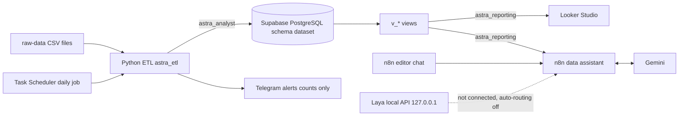

# 02 — System blueprint

Last checked: 2026-11-18

All data is synthetic. This page shows the components, how data moves, and who may touch what.

## Components

| Component | Code / location | Role |
|---|---|---|
| Raw CSV files | `raw-data/` (not in Git) | Source deliveries, 10 tables |
| Python ETL | `src/astra_etl`, run with `.\astra etl` | Read new files once, clean, validate, load, quarantine the rest |
| Supabase PostgreSQL | schema `dataset`, `sql/migrations/` | Clean tables, audit tables, quarantine, `v_*` views |
| Looker Studio | report built by hand (H5), spec in [doc 34](34-looker-studio-dashboards.md) | Dashboards over the `v_*` views |
| n8n data assistant | `src/astra_n8n`, workflow `ASTRA_DATA_ASSISTANT` ([doc 35](35-n8n-data-assistant.md)) | Chat with Gemini and 9 fixed SELECT tools |
| Telegram alerts | `src/astra_etl/notify.py` ([doc 32](32-telegram-alerts.md)) | Counts-only messages after each real load |
| Task Scheduler | `scripts/daily_etl.ps1`, `scripts/register_daily_task.ps1` ([doc 33](33-daily-schedule.md)) | Runs `.\astra daily` every day |
| Laya | `src/decision_engine`, local API on 127.0.0.1 ([docs 22–29](22-laya-architecture.md)) | Local classifier for incident category and request routing |

## System architecture

The dotted line is a plan only. The Laya n8n workflow `ASTRA_LAYA_DECISION_ENGINE` is not built ([doc 26](26-laya-n8n-integration.md)).

## Data flow

1. A CSV file arrives in `raw-data/<table>.csv` or `raw-data/<table>/`. See [doc 04](04-source-inventory.md).
2. The scheduled task (daily 08:30 WIB) or a manual `.\astra etl` starts the ETL.
3. The ETL reads only files it has not read before. It cleans each row, checks keys, and splits rows into
   loaded, quarantined and exact duplicates. It also rechecks every row already in quarantine.
4. The ETL writes the run in one transaction as `astra_analyst`.
5. The ETL sends counts-only Telegram alerts (success, failure, quarantine spike, stale source).
6. Looker Studio and the n8n assistant read the `v_*` views as `astra_reporting`.
7. An analyst fixes quarantined rows with `.\astra fix`, and the next run loads what now passes.

Details: [doc 31](31-etl-and-quarantine.md), [doc 33](33-daily-schedule.md).

## Trust boundaries and database roles

| Consumer | Database role | Can do | Cannot do |
|---|---|---|---|
| Python ETL, `.\astra fix` | `astra_analyst` | SELECT, INSERT, UPDATE on all `dataset` tables; DELETE on `quarantine_record` only | Other DELETE, TRUNCATE, DDL |
| Looker Studio | `astra_reporting` | SELECT on views and on non-PII tables or columns | Any write; read names, emails, phones, salaries, raw records |
| n8n data assistant | `astra_reporting` (credential `Astra reporting (read-only)`) | Same as above, through 9 parameterized SELECTs on `v_*` views | Write; run SQL written by the model |
| Supabase `anon`, `authenticated`, PUBLIC | none | Nothing | Everything |

Boundaries:

- **Internet to database.** The `dataset` schema is not in the Supabase Data API exposed schemas.
  Connections use the Session pooler with SSL (`verify-full` for the ETL).
- **LLM to database.** The model fills typed parameters only. The queries are fixed, and values reach PostgreSQL as bind parameters.
- **n8n to outside.** The chat trigger is not public. The editor listens on 127.0.0.1 only (`http://astra.localhost:5698`).
  A Telegram chat front end is not implemented, because it needs a public webhook ([doc 35](35-n8n-data-assistant.md)).
- **Laya.** The local API binds to 127.0.0.1 and needs a bearer token. Laya never runs SQL, changes data or sends messages ([doc 22](22-laya-architecture.md)).
- **Alerts.** Telegram messages contain counts and category names, never row content ([doc 32](32-telegram-alerts.md)).
- **Secrets.** Credentials live in `.env` and `secrets/`, both outside Git. `.env.example` lists the variable names.

## Where to read more

- Tables, grants and views: [doc 03](03-data-architecture.md), [doc 30](30-database-schema.md).
- Launcher commands: `.\astra` with no arguments prints the usage.
- Progress and open work: [STATUS](STATUS.md).
