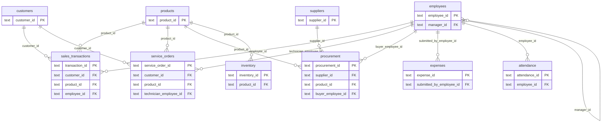

# 03 — Data architecture

Last checked: 2026-11-18

Everything lives in the PostgreSQL schema `dataset` on Supabase. The migrations in `sql/migrations/` are the source of truth.
Full migration list, grants, advisor findings and privilege tests: [doc 30](30-database-schema.md).

## Layers

| Layer | Objects | Written by | Read by |
|---|---|---|---|
| Core tables (10) | `customers`, `employees`, `suppliers`, `products`, `sales_transactions`, `service_orders`, `procurement`, `inventory`, `expenses`, `attendance` | ETL (`astra_analyst`) | ETL; `astra_reporting` only on non-PII columns |
| Run and audit | `etl_run`, `etl_run_file`, `dq_check_result`, `source_file` | ETL | ETL; `astra_reporting` |
| Quarantine | `quarantine_record` (rows still to fix), `quarantine_edit` (edit log), `quarantine_archive` (rows that left, labels only), `quarantine_rule` (12-rule catalog) | ETL and `.\astra fix` | ETL; `astra_reporting` on label columns only |
| Reporting views (15) | See below | Migrations | Looker Studio, n8n assistant |

Notes:

- Every core table has a primary key `text`, `CHECK` constraints for closed value sets, and lineage columns
  `etl_run_id`, `source_row_number`, `loaded_at`.
- Money is `numeric(18,2)` IDR and never negative. Dates are `date`. Some totals are generated columns
  (`gross_amount`, `net_amount`, `total_amount`, `total_cost`, `stock_value`).
- Rows that fail a rule are never loaded. They go to `quarantine_record` with a rule id and the failed column names.
  Rule catalog and lifecycle: [doc 31](31-etl-and-quarantine.md).
- `etl_run_file` stores the SHA-256 of each file read and the reconciliation `read = loaded + quarantined + duplicate`.
- `source_file` registers each file read, so no file is read twice.
- RLS is enabled on all tables. The two app roles have `true` policies, and isolation comes from role privileges.

## Views

| View | Purpose |
|---|---|
| `v_customers_public`, `v_employees_public`, `v_suppliers_public` | Master data without PII |
| `v_sales_daily` | Sales by day, branch, category, payment method and status |
| `v_service_daily` | Service orders by day, branch, type and status |
| `v_expenses_monthly` | Expenses by month, branch, department, category and approval |
| `v_inventory_latest` | Latest stock snapshot per product and warehouse |
| `v_procurement_monthly` | Purchase orders by month, category, payment terms and status |
| `v_attendance_daily` | Attendance by day, branch, department and status |
| `v_customer_activity_monthly` | Distinct buying customers per month and customer type |
| `v_etl_run_summary` | Counts per run and table |
| `v_quarantine_open`, `v_quarantine_lifecycle` | Quarantine counts by table and rule |
| `v_quarantine_monitor`, `v_quarantine_flow_daily` | Rows still to fix, and rows in and out per day |

All views use `security_invoker = true`, so the caller's column grants apply. Grain and row counts: [doc 34](34-looker-studio-dashboards.md).
Migration 0009 dropped `quarantine_correction` and the view `v_correction_status`.

## Core table relationships

The foreign keys below are the ones in `20261117090200_dataset_core_tables.sql`.
Some keys may be blank in the source (see the table below). Orphan keys are quarantined, not loaded.
The diagram shows the parent link only, not whether the key may be blank.
Every core table also references `etl_run (run_id)` through `etl_run_id`. That link is left out of the diagram.

| Child column | Parent | Blank allowed |
|---|---|---|
| `sales_transactions.customer_id`, `product_id`, `employee_id` | `customers`, `products`, `employees` | Yes |
| `service_orders.customer_id`, `product_id`, `technician_employee_id` | `customers`, `products`, `employees` | Yes |
| `procurement.supplier_id`, `product_id`, `buyer_employee_id` | `suppliers`, `products`, `employees` | Yes |
| `inventory.product_id` | `products` | No |
| `expenses.submitted_by_employee_id` | `employees` | No |
| `attendance.employee_id` | `employees` | No |
| `employees.manager_id` | `employees` (self, deferrable) | Yes; an employee cannot be their own manager |

The ETL loads parents first, in this order: customers, employees, suppliers, products, sales_transactions, service_orders,
procurement, inventory, expenses, attendance (order of `SPECS` in `src/astra_etl/spec.py`).

Column-level detail: [doc 05](05-data-dictionary.md).
