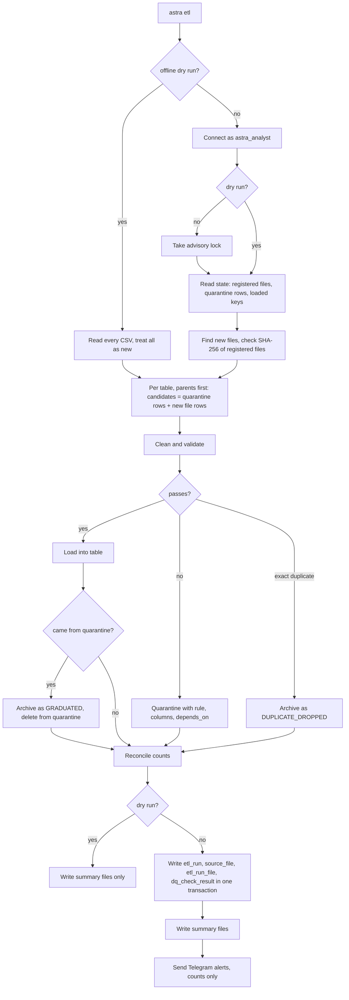

# 07 — ETL workflow

Last checked: 2026-11-18

This page follows one ETL run from source files to the database, the summary and the alerts.
Code: `src/astra_etl/__main__.py` (run control), `transform.py` (read and validate, no database),
`load.py` (all database writes), `fix.py` (edit quarantine), `notify.py` (alerts).
Rules and reason codes: [doc 06](06-data-quality-rules.md). Quarantine lifecycle: [doc 31](31-etl-and-quarantine.md).
Daily job: [doc 33](33-daily-schedule.md). Alerts: [doc 32](32-telegram-alerts.md).

## Flow



## Steps

1. **Start.** `.\astra etl` runs `python -m astra_etl etl`. The launcher sets `PYTHONPATH`.
2. **Connect.** Unless `--offline`, the run connects as `astra_analyst` (`db.connect("analyst")`) with `verify-full` SSL by default.
   Credentials come from `.env`; the CA file path comes from `DATABASE_SSLROOTCERT`.
3. **Lock.** A load takes the session advisory lock (`pg_try_advisory_lock`). A second load stops with "another ETL run is in progress". A dry run takes no lock.
4. **Read state** (`load.read_state`): registered files from `dataset.source_file`, all rows in `dataset.quarantine_record`, and every primary key already loaded.
5. **Find new files** (`load.new_files`, `transform.discover`). For each table the run looks at `raw-data/<table>.csv`, then `raw-data/<table>/*.csv` in name order.
   - A file already registered with the same SHA-256 is skipped.
   - A registered file name with a different SHA-256 stops the run with an error. Ingested files are never re-read.
   - A new name whose content equals a registered file of the same table is skipped with a log line.
   - Files are read as UTF-8 (BOM allowed). The header is line 1, so the first data row is line 2.
   - A file that lacks a source column stops the run.
6. **Clean and validate** (`transform.transform`), table by table, parents first. Candidates are the rows still in quarantine (with analyst edits) plus the rows of new files.
   The check order is in [doc 06](06-data-quality-rules.md). This step touches no database write path.
7. **Reconcile.** Two assertions run on every run, including dry runs. A failure stops the run at stage `validate`.
   - Per new file: `rows_read = rows_loaded + rows_quarantined + rows_duplicate`.
   - Per table: quarantine rows rechecked = graduated + still open + dropped as duplicate.
   Every rule id on a quarantined or duplicate row must exist in the catalog.
8. **Write** (`load.load`), only on a real load, as one transaction after a first small commit:
   1. Insert an `etl_run` row (status `RUNNING`, trigger type, code version) and commit it, so a crash stays visible.
   2. Per table: plain `INSERT` of the passing rows; copy graduated rows to `quarantine_archive` (`GRADUATED`) and delete them from `quarantine_record`; archive quarantine rows that became exact duplicates (`DUPLICATE_DROPPED`); refresh the labels of rows that still fail; insert new failing rows into quarantine; archive new exact duplicates.
   3. Per file: one row in `dataset.source_file` and one in `dataset.etl_run_file` (name, SHA-256, counts).
   4. Per table: rows in `dataset.dq_check_result`.
   5. Set the run to `SUCCEEDED` with `finished_at`, then commit.
   On any error the transaction rolls back, the run row is set to `FAILED` with `notes = error: <ExceptionClass>`, and the error is raised.
9. **Summary.** The run writes `reports/etl/last_run_summary.json` and `.md`. They hold counts and rule names only, no record content.
10. **Alerts.** After a real load, unless `--no-notify`, the run sends Telegram alerts built from the summary.

## Idempotency and keys

- Re-running without new files and without quarantine edits loads nothing new. The registered files are skipped, and quarantine rows are rechecked and stay as they were.
- Business tables use a plain `INSERT`. There is no `UPDATE` and no upsert, so a loaded row is never overwritten.
- A new row whose key is already loaded is either dropped as `EXACT_DUPLICATE_ROW` (same values) or quarantined as `DUPLICATE_PRIMARY_KEY` (different values).
  Updating a loaded row is Not implemented; [doc 31](31-etl-and-quarantine.md) lists it as a known limit.
- `astra_analyst` has no `DELETE` on business tables. It can delete only from `quarantine_record`, and every delete goes through the archive.
- One load at a time, enforced by the advisory lock.

## Requeue and graduation of quarantined rows

There is no separate requeue command. Every run puts all quarantine rows back through validation.

1. List the rows: `.\astra fix list`.
2. Edit a value: `.\astra fix set ...`. The old value is saved in `dataset.quarantine_edit`.
3. Run `.\astra etl`. A row that now passes is inserted into its table, archived as `GRADUATED`, and deleted from quarantine.
   A row that still fails stays, with refreshed labels and `last_checked_run_id`.
4. Rows with `ORPHAN_PARENT_QUARANTINED` graduate in the same run as their parent, because tables run parents first.
5. To remove a row that should never load: `.\astra fix drop ID --reason "..."`. It is archived as `DROPPED`.

The `fix` subcommands are listed in [doc 08](08-python-documentation.md).

## Recording of run, batch, checksum and duration

| Item | Where it is recorded |
|---|---|
| Run ID | `dataset.etl_run.run_id` (a UUID made by the database). Every loaded row carries it as `etl_run_id`. Quarantine rows carry `run_id` (first run) and `last_checked_run_id` |
| Batch ID | Not implemented as a separate field. The run ID is the batch identifier. One run can read several files per table |
| Checksum | SHA-256 of each source file in `dataset.source_file.file_sha256` and `dataset.etl_run_file.file_sha256` |
| Row counts | `dataset.etl_run_file`: `rows_read`, `rows_loaded`, `rows_quarantined`, `rows_duplicate` per run, table and file |
| Rule counts | `dataset.dq_check_result`: one row per run, table and check. Check names are the lower-cased rule ids of new rows (severity `ERROR`, `exact_duplicate_row` is `INFO`) plus `quarantine_recheck` (`INFO`) |
| Duration | `dataset.etl_run.started_at` and `finished_at`. No duration column exists; subtract the two. `started_at` is when the load began, after files were read and validated. The console prints `done in N s`, and the success alert prints `Took N s` |
| Trigger | `dataset.etl_run.trigger_type`: `MANUAL`, `SCHEDULED` or `REPROCESS` |
| Code version | `dataset.etl_run.code_version`: the short Git commit hash, or NULL if Git is not available |
| Status | `dataset.etl_run.status`: `RUNNING`, `SUCCEEDED`, `FAILED`. The table also allows `PARTIAL`, but no code sets it |

A run that is killed during the load (for example by the 30 minute limit in [doc 33](33-daily-schedule.md)) leaves its `RUNNING` row, because that row is committed first. The open data transaction is rolled back by PostgreSQL.

## Alerts

Sent by `notify.deliver` after a real load. A failed send never fails the run. Counts only; no keys, file names or personal data.

| Alert | When |
|---|---|
| `ETL_SUCCESS` | After every successful load |
| `QUARANTINE_SPIKE` | New quarantined rows reach `quarantine_new_rows_warn` (500) or `quarantine_new_pct_warn` (5.0 percent of rows read). Values come from `config/alert_policy.json` |
| `STALE_SOURCE` | Trigger is `SCHEDULED` and no new file was found (policy `stale_source_warn_on_scheduled`) |
| `ETL_FAILED` | Any exception in a non-dry run. Contains only the stage name and the exception class |
| `JOB_TIMEOUT` | Sent by `scripts/daily_etl.ps1` when it stops a run after the time limit |

If Telegram is not set up in `.env`, alerts are off and the run prints `Telegram alerts off (not set up in .env)`.
Details: [doc 32](32-telegram-alerts.md).

## Modes

| Mode | Command | Reads database | Writes database | Writes summary files | Alerts |
|---|---|---|---|---|---|
| Full load | `.\astra etl` | yes | yes | yes | yes |
| Dry run | `.\astra etl --dry-run` | yes (state only, then rolls back) | no | yes (`mode` is `dry-run`) | no |
| Offline dry run | `.\astra etl --dry-run --offline` | no | no | yes | no |
| Full load without alerts | `.\astra etl --no-notify` | yes | yes | yes | no |
| Scheduled | `.\astra etl --trigger SCHEDULED` (used by `scripts/daily_etl.ps1`) | yes | yes | yes | yes |
| Reprocess label | `.\astra etl --trigger REPROCESS` | yes | yes | yes | yes. Only the trigger label changes; the run behaves as a full load |

```powershell
.\astra etl --dry-run
```
```powershell
.\astra etl --dry-run --offline
```
```powershell
.\astra etl
```

`--offline` without `--dry-run` is refused. With `--offline`, every file is treated as new and the database is not used.

### Not implemented

- Single-table reprocessing (no `--table` option on `etl`). A run always covers all ten tables.
- Re-reading a source file that was already loaded. Send corrected data as a new file or fix the quarantine row.
- A validation-only mode separate from `--dry-run`. `--dry-run` is the validation-only mode.
- Updating rows that are already loaded (for example a new product price).
- A batch ID separate from the run ID.
- Automatic retry of a failed load. Run `.\astra etl` again.
