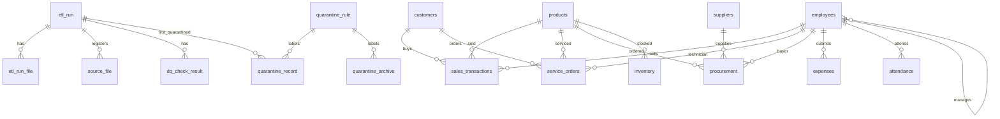

# 09 — PostgreSQL documentation

Last checked: 2026-11-18

This page describes schema `dataset` as defined by `sql/migrations/` (10 migrations, state after 0010).
All data is synthetic. The Supabase project reference is `<project_ref>` and is never written in the repository docs.
Column-level detail, advisor findings and the privilege test results are in [doc 30](30-database-schema.md).
Each migration is described in [doc 10](10-sql-reference.md).

## Schema rules

- Schema `dataset` has no access for `PUBLIC`, `anon` or `authenticated`. It must stay out of the Supabase Data API exposed schemas.
- All 18 tables have row level security enabled.
- Business tables carry lineage columns `etl_run_id`, `source_row_number` and `loaded_at`.
- Generated columns: `sales_transactions.gross_amount` and `net_amount`, `service_orders.total_amount`, `procurement.total_cost`, `inventory.stock_value`.
- Money is `numeric(18,2)` in IDR and never negative. Codes are trimmed upper case from closed sets enforced by `CHECK` constraints.

## ER overview

Every business table also references `etl_run` through `etl_run_id` (not drawn).

## Tables: ETL control and quarantine

| Table | Purpose | Key | Row source |
|---|---|---|---|
| `etl_run` | One row per ETL run: status, trigger, code version, timing | `run_id` (uuid) | `load.load` inserts it, then sets `SUCCEEDED` or `FAILED` |
| `etl_run_file` | Per file and run: SHA-256 and counts (`read = loaded + quarantined + duplicate`) | `run_id`, `table_name`, `file_name` | ETL, one row per new file |
| `source_file` | Registry of every file the ETL has read. A registered file is never read again | `file_id`; unique on `(table_name, file_name)` and `(table_name, file_sha256)` | ETL, plus the files loaded before migration 0008 |
| `dq_check_result` | Counts per rule check, per run and table | `run_id`, `table_name`, `check_name` | ETL |
| `quarantine_rule` | Catalog of 12 quarantine rules: issue code, decision, graduation path, description, remediation | `rule_id` | Seeded by migrations (last in 0008). See [doc 06](06-data-quality-rules.md) |
| `quarantine_record` | Live quarantine: only rows that still need fixing. Holds `raw_record` (jsonb, may contain personal data), `rule_id`, `failed_columns`, `depends_on`, `corrected_columns`, `source_file`, `last_checked_run_id` | `quarantine_id`; unique on `(table_name, source_file, source_row_number)` | ETL inserts and refreshes; `astra fix set` edits; deleted when a row graduates or is dropped |
| `quarantine_archive` | Rows that left quarantine, labels only, no raw values. `resolution` is `GRADUATED`, `DUPLICATE_DROPPED`, `DROPPED` or `SUPERSEDED` | `archive_id` | ETL and `astra fix drop`. Includes history moved by migration 0008 |
| `quarantine_edit` | Log of every analyst edit with old value, new value, reason, author and time. May hold personal data | `edit_id` | `astra fix set`. 2 legacy rows came from the dropped correction table (`legacy_correction_id`) |

`quarantine_record.status` can only be `OPEN` since 0008. The columns `suggested_category`, `suggested_category_source` and `suggested_confidence` exist (a Laya hint) but the ETL code does not fill them.
`etl_run.status` allows `RUNNING`, `SUCCEEDED`, `PARTIAL`, `FAILED`; no code sets `PARTIAL`.

## Tables: business data

All are loaded by the ETL from the CSV files in `raw-data/`. Foreign keys are nullable where the source may be blank.

| Table | Purpose | Key | Foreign keys | Personal or sensitive columns |
|---|---|---|---|---|
| `customers` | Customer master | `customer_id` | none | `customer_name`, `email`, `phone` |
| `employees` | Employee master with the management hierarchy | `employee_id` | `manager_id` to `employees` (deferrable) | `employee_name`, `email`, `monthly_salary` |
| `suppliers` | Supplier master | `supplier_id` | none | `contact_name`, `email`, `phone` |
| `products` | Product master with list price and standard cost | `product_id` | none | none |
| `sales_transactions` | Sales fact | `transaction_id` | `customer_id`, `product_id`, `employee_id` | none |
| `service_orders` | After-sales service fact | `service_order_id` | `customer_id`, `product_id`, `technician_employee_id` | none |
| `procurement` | Purchase orders | `procurement_id` | `supplier_id`, `product_id`, `buyer_employee_id` | none |
| `inventory` | Stock snapshots per product and warehouse | `inventory_id` | `product_id` (required) | none |
| `expenses` | Operating expenses | `expense_id` | `submitted_by_employee_id` (required) | none |
| `attendance` | Daily attendance with check-in and check-out | `attendance_id` | `employee_id` (required) | none |

## Views (all `security_invoker = true`)

`security_invoker` means a view runs with the caller's own privileges and RLS, not the owner's. A view cannot give `astra_reporting` more than its column grants allow.
Both roles have `SELECT` on every view. `anon`, `authenticated` and `PUBLIC` have none.

| View | Purpose | Defined in |
|---|---|---|
| `v_customers_public` | Customers without name, email or phone | 0005 |
| `v_employees_public` | Employees without name, email or salary | 0005 |
| `v_suppliers_public` | Suppliers without contact, email or phone | 0005 |
| `v_sales_daily` | Daily sales by branch, product category, payment method and status, with cost and gross margin | 0005, replaced in 0010 |
| `v_service_daily` | Daily service orders and revenue | 0005 |
| `v_expenses_monthly` | Monthly expenses by branch, department, category and approval status | 0005 |
| `v_inventory_latest` | Latest snapshot per product and warehouse, with `below_reorder_point` | 0005 |
| `v_etl_run_summary` | Per run and table: counts and `load_pct` | 0005 |
| `v_quarantine_open` | Rows still in quarantine by table, issue and rule | 0005, replaced in 0006 |
| `v_quarantine_lifecycle` | Open rows plus archived rows by table, rule and status | 0006, replaced in 0008 |
| `v_procurement_monthly` | Monthly purchase orders, with overdue counts | 0010 |
| `v_attendance_daily` | Attendance by branch, department and status, with hours worked | 0010 |
| `v_customer_activity_monthly` | Distinct buying customers per month and customer type (completed sales) | 0010 |
| `v_quarantine_monitor` | Rows still to fix by table, rule, file, failed columns and age bucket | 0010 |
| `v_quarantine_flow_daily` | Rows entering and leaving quarantine per day | 0010 |

The view `v_correction_status` and the table `quarantine_correction` existed from 0007 to 0008 and were dropped by 0009.
Column names and sample queries: [doc 10](10-sql-reference.md). Dashboards: [doc 34](34-looker-studio-dashboards.md).

## Roles

Created in `20261117090000_astra_roles.sql`. No password is set in SQL; the owner sets passwords in the Supabase SQL editor.
Both roles are `LOGIN NOSUPERUSER NOCREATEDB NOCREATEROLE NOREPLICATION NOBYPASSRLS NOINHERIT`.

| Setting | `astra_analyst` | `astra_reporting` |
|---|---|---|
| Used by | The ETL (`db.connect("analyst")`) and `astra fix` | Looker Studio, the n8n assistant, Navicat (`db.connect("reporting")`) |
| Connection limit | 5 | 10 |
| `search_path` | `dataset` | `dataset` |
| `statement_timeout` | 15 min | 60 s |
| `idle_in_transaction_session_timeout` | 5 min | 60 s |
| `default_transaction_read_only` | not set | `on` |

### Grants of `astra_analyst`

| Objects | Privileges |
|---|---|
| Schema `dataset` | `USAGE` |
| `etl_run`, `etl_run_file`, `dq_check_result`, the 10 business tables | `SELECT`, `INSERT`, `UPDATE` |
| `quarantine_record` | `SELECT`, `INSERT`, `UPDATE`, `DELETE` (the only table with `DELETE`) |
| `quarantine_rule` | `SELECT` |
| `source_file`, `quarantine_archive`, `quarantine_edit` | `SELECT`, `INSERT` (append-only) |
| All views | `SELECT` |
| Sequences in `dataset` | `USAGE` |
| Not granted | `TRUNCATE`, DDL, `DELETE` on any other table |

### Grants of `astra_reporting`

| Objects | Privileges |
|---|---|
| Schema `dataset` | `USAGE` |
| `etl_run`, `etl_run_file`, `dq_check_result`, `source_file`, `quarantine_rule`, `products`, `sales_transactions`, `service_orders`, `procurement`, `inventory`, `expenses`, `attendance` | `SELECT` on all columns |
| `customers` | `SELECT` on `customer_id`, `customer_type`, `city`, `registration_date`, `customer_status`, `etl_run_id`, `loaded_at` |
| `employees` | `SELECT` on `employee_id`, `department`, `job_title`, `branch`, `hire_date`, `employment_status`, `manager_id`, `etl_run_id`, `loaded_at` |
| `suppliers` | `SELECT` on `supplier_id`, `supplier_name`, `city`, `payment_terms`, `supplier_status`, `etl_run_id`, `loaded_at` |
| `quarantine_record` | `SELECT` on `quarantine_id`, `run_id`, `table_name`, `source_row_number`, `issue_code`, `status`, `suggested_category`, `suggested_category_source`, `suggested_confidence`, `created_at`, `resolved_at`, `resolved_run_id`, `rule_id`, `failed_columns`, `corrected_columns`, `source_file`, `last_checked_run_id`, `last_checked_at`. Not `raw_record`, `record_key`, `depends_on` or `issue_detail` |
| `quarantine_archive` | `SELECT` on `archive_id`, `table_name`, `source_file`, `rule_id`, `issue_code`, `failed_columns`, `edited_columns`, `first_run_id`, `created_at`, `resolution`, `resolved_run_id`, `resolved_at`. Not keys, notes or `resolved_by` |
| `quarantine_edit` | `SELECT` on `edit_id`, `table_name`, `column_name`, `edited_at`. Not keys, values, reasons or authors |
| All views | `SELECT` |
| Not granted | any write, personal columns (names, email, phone, salary, contact name), `raw_record` |

## Row level security

- RLS is enabled on all 18 tables (migrations 0004, 0006, 0008).
- Policies exist per role and command. For both app roles the condition is `true` (synthetic, single-tenant data), so isolation comes from role privileges and column grants, not from row filters.
- Policy names: `analyst_select`, `analyst_insert`, `analyst_update` (the 14 tables from 0002 and 0003), `analyst_delete` (`quarantine_record` only), `reporting_select` (every one of the 18 tables has one).
- `quarantine_rule`: `analyst_select` and `reporting_select` only.
- `source_file`, `quarantine_archive`, `quarantine_edit`: `analyst_select`, `analyst_insert`, `reporting_select`.
- `anon` and `authenticated` have no policy and no grant. Default privileges for future objects created by `postgres` in `dataset` are revoked from `PUBLIC`, `anon` and `authenticated`.
- The test `sql/tests/dataset_privilege_tests.sql` checks this; see [doc 10](10-sql-reference.md).

## Known open item

The Supabase advisor flagged `public.rls_auto_enable()` as `SECURITY DEFINER` and callable by `anon` and `authenticated`. The function is not created by these migrations. It is open for an owner decision; see [doc 30](30-database-schema.md).
