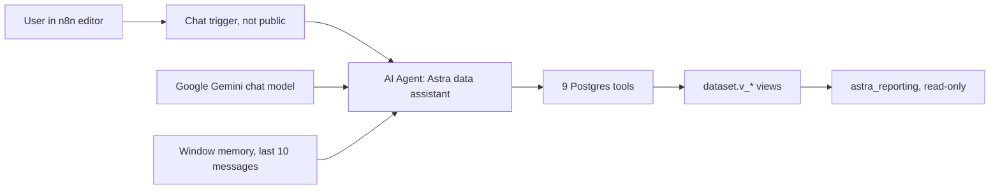

# 13 — n8n AI agent

Last checked: 2026-11-18

Overview of the n8n workflows this project ships. Tool details, install steps and checks are in
[doc 35](35-n8n-data-assistant.md). All data is SYNTHETIC.

## Workflows

| Workflow | Source | Status |
|---|---|---|
| `ASTRA_DATA_ASSISTANT` | Generated by `src/astra_n8n` (`.\astra n8n build`) | Imported and verified live 2026-11-18. Left inactive |
| `ASTRA_LAYA_DECISION_ENGINE` | — | **Not implemented.** Planned in [doc 26](26-laya-n8n-integration.md) |

`ASTRA_DATA_ASSISTANT` is the only workflow the project ships. No other n8n workflow is created or changed by this repo.
The generated file `n8n\build\astra_data_assistant.json` is not in Git.

## Topology



- The agent allows at most 8 tool iterations per question. Model temperature is 0.1.
- Each tool is one fixed `SELECT` on a `dataset.v_*` view. The LLM never writes SQL.
  It only fills typed values (dates, branch, dimension), which reach PostgreSQL as query parameters.
- The nine tools: `get_sales_kpis`, `get_sales_breakdown`, `get_sales_monthly`, `get_service_kpis`,
  `get_procurement_inventory`, `get_expense_summary`, `get_attendance_kpis`, `get_customer_activity`, `get_data_quality_status`.
- All tools use one Postgres credential named `Astra reporting (read-only)`. Gemini uses the credential `Google Gemini(PaLM) Api account`.
  The JSON holds credential names only, no ids or secrets.

## Commands

```powershell
.\astra n8n lint
```
```powershell
.\astra n8n check-live
```
```powershell
.\astra n8n build
```
```powershell
.\astra n8n-start
```

`lint` is offline. `check-live` connects to the database as `astra_reporting`. `build` needs `LLM_MODEL` in `.env`.

## The Astra n8n instance

`.\astra n8n-start` starts a separate n8n for this project, so it runs next to other n8n instances.

| Setting | Value |
|---|---|
| Editor address | http://astra.localhost:5698 (open this, not `127.0.0.1:5698`: cookies ignore the port and another n8n overwrites the login) |
| Listen address | `127.0.0.1` only |
| Task runner broker | `127.0.0.1:5699` |
| Data folder | `%USERPROFILE%\.n8n-astra` (outside the repo; holds credentials and the encryption key) |
| Telemetry | off (`N8N_DIAGNOSTICS_ENABLED=false`) |
| CA | `NODE_EXTRA_CA_CERTS` points to `secrets\supabase-ca.crt`, so the Postgres credential can use SSL Require without "Ignore SSL Issues" |
| Cookie | `N8N_SECURE_COOKIE=false`, only because the editor is plain HTTP on `127.0.0.1`. Do not copy this to a reachable n8n |

Credentials made in another n8n instance are not visible here. Back up `%USERPROFILE%\.n8n-astra\.n8n\config`: it holds the key that decrypts the stored credentials.

## Verification

- Offline: `.\astra n8n lint` 9/9 OK; 34 offline tests in `tests/n8n/test_assistant.py` ([doc 35](35-n8n-data-assistant.md)).
- Database: `.\astra n8n check-live` ran all 9 tools and matched the 2025 reference values. The reporting role cannot INSERT.
- Live in n8n, 2026-11-18: the question "Berapa net revenue 2025?" returned Rp 54.269.362.661.171 (matches [doc 34](34-looker-studio-dashboards.md) S1).
  The agent called `get_sales_kpis`. Model: `gemini-3.5-flash`.

## Limits

- No Telegram chat. n8n's Telegram Trigger needs a public webhook URL; this n8n is loopback only. See [doc 11](11-telegram-alerting.md).
- No Laya routing in n8n. The Laya workflow is not built ([doc 26](26-laya-n8n-integration.md)).
- The workflow is imported inactive and the chat trigger is not public. Only signed-in n8n users can chat, in the editor.

Gemini setup, model ids and rate-limit lessons: [doc 14](14-gemini-integration.md).
