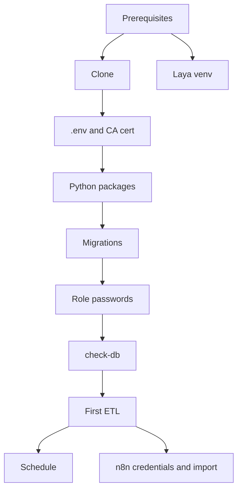

# 18 — Deployment guide (new Windows PC)

Last checked: 2026-11-18

This page sets up the platform on a new Windows PC. Everything runs locally. The database is hosted on Supabase.
Run commands in Windows PowerShell 5.1 or cmd, from the project folder.
Steps only a person can do (accounts, secrets, approvals) are in [HUMAN-STEPS.md](HUMAN-STEPS.md).



## 1. Prerequisites

| Tool | Version used on the project PC |
|---|---|
| Windows | 11 (build 10.0.26300) |
| Python | 3.12 (3.12.1 was verified) |
| Node.js | 24 (v24.18.0) |
| n8n | 2.35.7 |
| Git | 2.55.0 |

- The PostgreSQL client (`psql`, `pg_dump`) is not required to run the platform. It is not installed on the project PC.
- Docker is not required.
- You need a Supabase project, a Telegram bot and a Gemini API key. Creating them is a human step (H1, H3, H4).

## 2. Clone

```powershell
git clone https://github.com/farisradifana/ai-data-analyst-astra.git
```
```powershell
cd ai-data-analyst-astra
```

The repository does not contain `raw-data\`, `.env`, `secrets\` or any dump. Restore the source CSV files into `raw-data\` yourself
(first delivery as `raw-data\<table>.csv`, later files in `raw-data\<table>\`).

## 3. Python packages for the ETL

```powershell
python -m pip install -r requirements.txt
```

This installs `psycopg2-binary`, `python-dotenv` and `pandas` (versions in `requirements.txt`). The ETL runs on this system Python.

## 4. Configuration

1. Copy `.env.example` to `.env` (gitignored). Fill it in by hand. Never paste secrets into chat.

```powershell
copy .env.example .env
```

2. Fill the database block from Supabase, Connect, Session pooler: `DATABASE_HOST` (an `aws-1-...pooler.supabase.com` host), `DATABASE_PORT=5432`, `DATABASE_NAME=postgres`, `DATABASE_SSLMODE=verify-full`, `DATABASE_SSLROOTCERT=secrets/supabase-ca.crt`, `DATABASE_USER=astra_analyst`, `REPORTING_DB_USER=astra_reporting` and both passwords. `SUPABASE_PROJECT_REF` is the 20-character ref only.
3. Save the Supabase CA certificate as `secrets\supabase-ca.crt` (Supabase, Settings, Database, SSL certificate).
4. Telegram, `LLM_MODEL` and `LLM_MODEL_KEY` values: see H3 and H4.
5. Leave `N8N_ENCRYPTION_KEY` empty.

Why the host and port matter: [doc 17](17-troubleshooting.md).

## 5. Database: migrations and role passwords

Skip this section if you reuse the existing Supabase project. Do it for a new project.

1. The 10 files in `sql/migrations/` are applied in file-name order. This changes the database, so the owner must approve it. Claude applies them through the Supabase connector after approval (HUMAN-STEPS H1), or you paste them into the Supabase SQL editor one by one. The list and content of each file is in [doc 30](30-database-schema.md).
2. Optional check: `sql/tests/dataset_privilege_tests.sql` runs in one block and always rolls back.
3. Set the role passwords yourself in the Supabase SQL editor. The roles are created without a password.

```sql
ALTER ROLE astra_analyst   PASSWORD '<long random>';
ALTER ROLE astra_reporting PASSWORD '<long random>';
```

Use the same passwords in `.env`. Keep `dataset` out of the Supabase Data API exposed schemas.

## 6. Check the connection

```powershell
.\astra check-db
```

It reports which `.env` keys are filled and whether both roles can log in. It prints no values.

## 7. First ETL

```powershell
.\astra etl --dry-run --offline
```
```powershell
.\astra etl --dry-run
```
```powershell
.\astra etl
```

- The first command needs no database. The second reads the database and writes nothing. The third loads the data and sends Telegram alerts if they are set up.
- The first load of the original files read 435,200 rows (see [doc 31](31-etl-and-quarantine.md)).
- The summary is in `reports/etl/last_run_summary.md`.

## 8. Schedule the daily job

```powershell
.\astra schedule -At 08:30
```
```powershell
.\astra schedule -Show
```

This registers the Task Scheduler entry `Astra Daily ETL` for the current user, with no admin rights. It runs only while you are signed in. See [doc 16](16-automation-runbook.md) and [doc 33](33-daily-schedule.md). Registering a schedule needs the owner's approval (H6).

## 9. n8n data assistant

1. Install Node.js and n8n 2.35.7. How n8n was installed on the project PC is not recorded. Check with `n8n --version`.
2. Set `LLM_MODEL` in `.env` to a plain Gemini id the key can use. Build the workflow.

```powershell
.\astra n8n lint
```
```powershell
.\astra n8n build
```

3. Start the separate Astra n8n. Open `http://astra.localhost:5698`.

```powershell
.\astra n8n-start
```

4. Create the owner account. Then create the credentials in this instance: a Postgres credential named exactly `Astra reporting (read-only)` (user `astra_reporting.<project_ref>`, SSL Require, "Ignore SSL Issues" off) and the Google Gemini(PaLM) credential `Google Gemini(PaLM) Api account`.
5. Import `n8n\build\astra_data_assistant.json` and test with a question. Steps and the expected answer: [doc 35](35-n8n-data-assistant.md).
6. Back up `%USERPROFILE%\.n8n-astra\.n8n\config` in a password manager.

Check the tools against the live database (read-only):

```powershell
.\astra n8n check-live
```

## 10. Laya (optional)

Laya runs in its own virtual environment `.venv-laya`. The unit tests (`.\astra test`) also use it, so create it if you want to run tests.
Install steps, pinned versions and model weights: [doc 23](23-laya-installation.md). Packages are pinned in `requirements-laya.txt`. Resource use: [doc 29](29-laya-cost-and-resource-usage.md).

## 11. Looker Studio

Looker Studio reports are built in the browser by a person. See [doc 34](34-looker-studio-dashboards.md) and HUMAN-STEPS H5.

## Verify the install

```powershell
.\astra test
```

All checks and counts: [doc 19](19-testing-and-validation.md).
