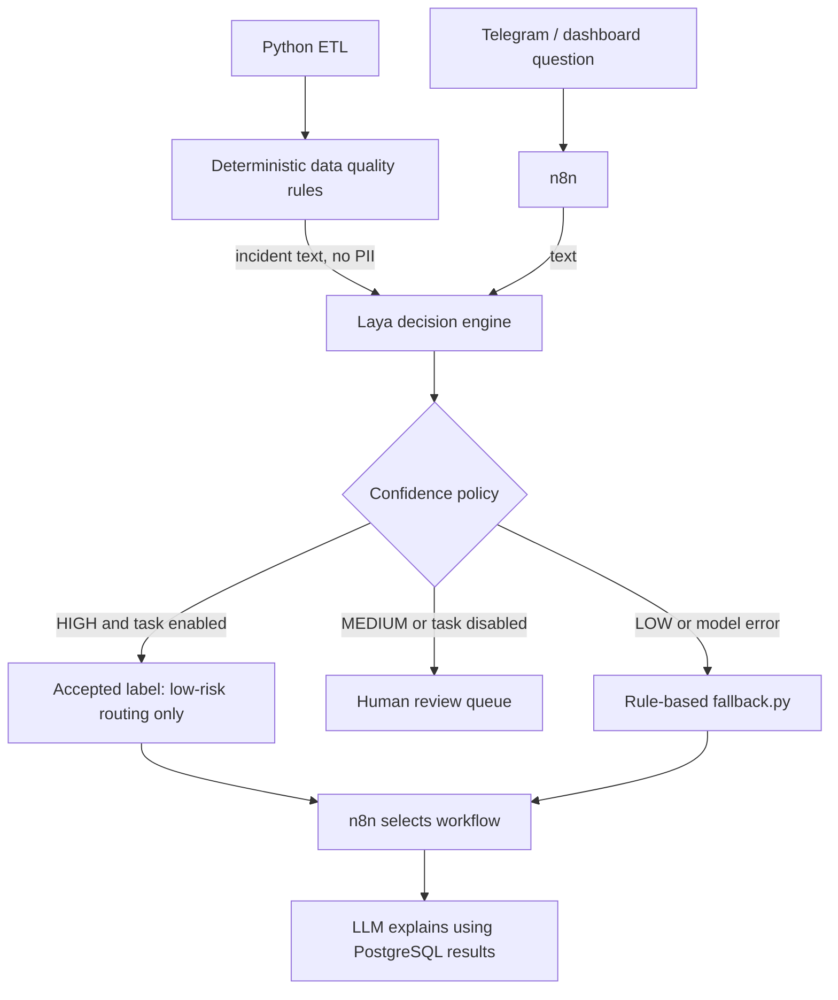

# 22 — Laya Decision Engine Architecture

Laya is a local "System 1" classifier. It picks one label from a closed list, gives a score on a
fixed rubric, or answers a yes/no check. It runs on this PC's CPU with open weights (Apache-2.0,
upstream https://github.com/NandhaKishorM/laya). No hosted API and no per-request fee.

## Roles

| Component | Authority over | Never does |
|---|---|---|
| pandas / SQL / pandera rules | whether a record passes or fails validation | — |
| Laya (`src/decision_engine`) | suggested incident category, request route | run SQL, change data, send messages, produce business figures, override validation |
| LLM via n8n (`LLM_MODEL`, Gemini first) | explanations, summaries, conversation | decide validation outcomes |
| n8n + application code | authorization, tool execution, Telegram sending | — |

## Modules (implemented)

| File | Purpose |
|---|---|
| `src/decision_engine/decision_schemas.py` | Closed label enums, label descriptions sent to Laya, request/decision models, 2,000-char input limit |
| `src/decision_engine/model_manager.py` | Loads one `laya.Router` once (CPU, `max_loaded=1`, vega lane off); `info()` reports package version and pinned revision |
| `src/decision_engine/laya_engine.py` | `DecisionEngine.decide()` → Laya → policy → decision; any exception or out-of-set label → fallback; JSON log without input text |
| `src/decision_engine/confidence_policy.py` | Bands HIGH/MEDIUM/LOW from `config/laya_policy.json`; no file → nothing auto-accepted |
| `src/decision_engine/fallback.py` | Auditable keyword rules; returns `UNKNOWN`/`UNKNOWN_ERROR` instead of guessing |
| `src/decision_engine/evaluation.py` | Benchmark on `evals/laya/*.jsonl` → `reports/laya/` |

Not yet implemented: `api.py` (FastAPI on 127.0.0.1), n8n workflow `ASTRA_LAYA_DECISION_ENGINE`,
Telegram routing. See [26-laya-n8n-integration.md](26-laya-n8n-integration.md).

## Hard limits

Laya never autonomously approves financial transactions, deletes or alters records, or makes
employment-related decisions. Anomaly or fraud-like findings always go to human review.
