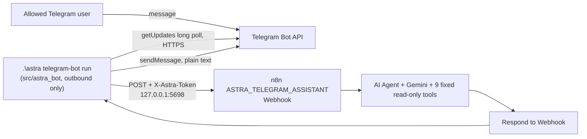

# 36 — Telegram chat for the data assistant (local bridge)

All data is SYNTHETIC. This doc covers asking the n8n data assistant ([doc 35](35-n8n-data-assistant.md))
questions from Telegram. It is separate from the ETL alerts ([doc 32](32-telegram-alerts.md)).

## Design: no public webhook

n8n's Telegram Trigger needs a public HTTPS URL, which means a tunnel or a hosted n8n. This project keeps
everything on loopback, so a small Python bridge does the Telegram side instead:

- **Nothing listens on a port.** The bridge only makes outbound calls: HTTPS to Telegram and HTTP to n8n on
  127.0.0.1. n8n itself listens on 127.0.0.1 only.
- **Same agent and tools as the n8n chat.** `.\astra n8n build` writes a second workflow,
  `n8n\build\astra_telegram_assistant.json`. It has the same system message, model, memory and 9 fixed SELECT
  tools on `dataset.v_*` as `astra_reporting`. Only the trigger is different: a Webhook (POST
  `/webhook/astra-assistant`, Header Auth) with a Respond to Webhook node. The LLM still writes no SQL.
- **Dedicated bot.** The alert bot already delivers its messages to another service's webhook (checked
  2026-11-18 with `getWebhookInfo`). Two receivers cannot share one bot, and the bridge never removes a webhook.
  So the bridge uses its own bot from @BotFather, `TELEGRAM_ASSISTANT_BOT_TOKEN`. If that is empty, it falls back to
  `TELEGRAM_BOT_TOKEN`, and then it stops while that bot still has a webhook.

## Rules the bridge enforces

| Rule | Behaviour |
|---|---|
| Allow-list | Only user ids in `TELEGRAM_ALLOWED_USER_IDS` are answered. Empty or malformed list: the bridge does not start (default deny) |
| Unauthorized user (spec case 16) | Reply "Not authorized for this bot." (at most once a minute per user). The assistant is not called. The console log shows the user id, so the owner can add it |
| Where | Private chat with the bot: any text is a question. The group in `TELEGRAM_CHAT_ID` (topics too, the answer goes to the same topic): `/ask <question>`, a message that mentions `@<bot username>`, or a reply to one of the bot's answers (follow-up question). Other group messages are dropped without a log line. Other chats are ignored |
| Privacy mode | `/ask` works with Telegram's default privacy mode. Mentions and replies need privacy mode **off** (@BotFather → `/setprivacy` → Disable): Telegram then delivers every group message to the bot; the bridge keeps only those meant for it and logs none of the others |
| Limits | Max 1000 characters per question; max 6 questions per user per 5 minutes |
| Backlog | Messages sent before the bridge started are skipped |
| Webhook URL | Must be http(s) on a loopback IP (`127.0.0.1` or `[::1]`; names such as `localhost` are refused because they depend on the resolver), without credentials or query. No proxy, no redirects |
| Webhook token | Header `X-Astra-Token`, 32+ characters, the same value in `.env` and in the n8n Header Auth credential |
| Errors | The user gets a generic "not available" reply. The log gets the HTTP status or error class only |
| Logs | User ids, chat type, lengths and timings. Never the question, the answer or a token |
| Running time | `--minutes` (default 480, max 1440). 20 polling errors in a row (network, malformed reply) stop it (exit 1). An HTTP 409 conflict (another program reads the bot) stops it (exit 3). No bot username from Telegram: it does not start |
| Refusal log | At most one log line and one reply per refused user per minute; the refusal table is capped at 1000 users |

The answers are aggregates from the read-only views. The tools have no access to personal data.

## Setup

Human step **H9** in [HUMAN-STEPS.md](HUMAN-STEPS.md) has the click path. In short:

1. Create a bot with @BotFather and put its token in `.env` as `TELEGRAM_ASSISTANT_BOT_TOKEN`.
2. Generate a webhook token. Put it in `.env` as `ASTRA_ASSISTANT_WEBHOOK_TOKEN` and in an n8n Header Auth
   credential named `Astra assistant webhook token` (header name `X-Astra-Token`).
3. Run `.\astra n8n build`, import `n8n\build\astra_telegram_assistant.json` into the Astra n8n and activate it.
4. Run `.\astra telegram-bot check --online`, then `.\astra telegram-bot run`.

## Commands

| Command | What it does |
|---|---|
| `.\astra telegram-bot check` | Checks the `.env` settings, without network |
| `.\astra telegram-bot check --online` | Also asks Telegram for the bot name and webhook state (sends no message). Exit 3 if a webhook is set |
| `.\astra telegram-bot run [--minutes N]` | Answers questions until the time limit. Ctrl+C stops it |

Exit codes: 0 time limit or Ctrl+C · 1 Telegram unreachable · 2 configuration error · 3 webhook or polling conflict.

## Tests

`tests/bot/test_bridge.py` (offline, fake Telegram and webhook): allow-list and refusal, group `/ask` rules,
topics, help, old messages, length and rate limits, failure replies, no question or answer text in logs,
webhook URL loopback checks, a webhook that is already set is left alone, backlog skip, bounded polling.
`tests/n8n/test_assistant.py` covers the webhook workflow: Header Auth, Respond node, the same tools, and no
secrets.

Not run live yet: the first real question through Telegram. That needs H9.

## Troubleshooting

| Symptom | Cause | Fix |
|---|---|---|
| `config error: ... TELEGRAM_ALLOWED_USER_IDS is empty` | No allow-list | Add your numeric user id. Run the bridge, message the bot, and read the id from the "refused" log line |
| `stopped: this bot has a Telegram webhook set` | The bot's messages go to another service | Use a dedicated bot (`TELEGRAM_ASSISTANT_BOT_TOKEN`). Do not remove the other service's webhook |
| No reply when tagging the bot in the group, `/ask` works | Privacy mode is on, so Telegram does not deliver the mention | @BotFather → `/setprivacy` → Disable, then remove the bot from the group and add it again |
| No reply at all in the group | Bridge not running, wrong `TELEGRAM_CHAT_ID`, or the new bot is not in the group | Check the bridge window; the group id must match; add the assistant bot (not only the alert bot) |
| `HTTP 409 conflict` | Another program polls the same bot | Stop the other bridge, or use another bot |
| Reply "not available", log `webhook HTTP 404` | Workflow not active, or wrong path | Activate `ASTRA_TELEGRAM_ASSISTANT` in n8n; use the production URL `/webhook/astra-assistant` |
| Log `webhook HTTP 403` or `401` | Token mismatch | Same value in `.env` and in the n8n credential; header name `X-Astra-Token` |
| Log `webhook unreachable (URLError)` | n8n not running | `.\astra n8n-start` |
| Reply after about 1–3 minutes | Gemini is slow or rate-limited | See doc 35 (model choice). The bridge waits up to 180 s |
