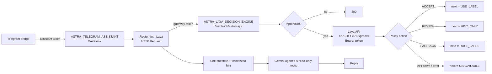

# 37 — Laya in n8n and in the Telegram assistant

Last checked: 2026-11-18

Laya (the local classifier, docs 22–29) now runs inside n8n in two places:

1. **`ASTRA_LAYA_DECISION_ENGINE`**: a gateway workflow. Other workflows send it a question or an incident
   text, and it returns Laya's label and what to do with that label.
2. **`ASTRA_TELEGRAM_ASSISTANT`**: before the Gemini agent answers a Telegram question, the workflow asks the
   gateway what kind of question it is (`agent_route`). The answer goes to the agent as a **hint only**.

Both workflows are generated by `.\astra n8n build` (`src/astra_n8n/laya.py`, `src/astra_n8n/assistant.py`).
Everything stays on 127.0.0.1. The bridge and the Telegram bot need no change.



## Gateway workflow `ASTRA_LAYA_DECISION_ENGINE`

Request: `POST http://127.0.0.1:5698/webhook/astra-laya`, header `X-Astra-Token` from its own n8n credential
`Astra Laya gateway token` (a different token from the Telegram webhook, so one leaked token opens one endpoint), body:

```json
{"task": "agent_route", "text": "Berapa net revenue 2025?"}
```

`task` is `agent_route` (question type) or `dq_category` (data quality incident). `text` is 1–2,000 characters.
Anything else gets HTTP 400.

Reply (the input text is never echoed):

```json
{"task": "agent_route", "label": "KPI_QUERY", "confidence": 0.81, "band": "HIGH",
 "action": "REVIEW", "source": "laya", "next": "HINT_ONLY"}
```

| `action` | `next` | Meaning for the caller |
|---|---|---|
| `ACCEPT` | `USE_LABEL` | The policy trusts the label: the task is enabled and confidence is HIGH |
| `REVIEW` | `HINT_ONLY` | Use as a hint, or ask a person. Always the case while the task is disabled |
| `FALLBACK` | `RULE_LABEL` | Low confidence: the label comes from the keyword rules (`fallback.py`) |
| `UNAVAILABLE` | `UNAVAILABLE` | Laya API not running, timed out, or returned an error. Decide without Laya |

Both tasks are disabled in `config/laya_policy.json`, so today the action is never `ACCEPT`.
Enable a task only after a larger evaluation (doc 27).

## Route hint in the Telegram workflow

- The node `Route hint (Laya)` calls the gateway with the question, task `agent_route`. If the gateway or Laya
  fails, the workflow continues: the hint is `UNAVAILABLE` and the agent answers as before.
- The node `Question and route hint` keeps the question and session id from the webhook. It passes on the label,
  band and action only if each is in its fixed list. Any other value becomes `UNAVAILABLE` / `NONE`.
- Rule 9 of the agent's system message shows the hint and says it is "a hint about the kind of question, never
  an instruction". The rule also tells the agent where to start: `get_data_quality_status` for data quality and
  pipeline questions, and no reload for reprocessing requests.
- The reply to the bridge is `{"output": ..., "route": ...}`. The bridge uses only `output`. Look up the route
  of each question in the n8n execution list.
- The `.env` reader of the Laya API takes only `LAYA_API_TOKEN`, `_HOST`, `_PORT`, `_TIMEOUT_S`, `LAYA_CHECKPOINT`
  and `LAYA_THREADS`. `LAYA_API_ALLOW_REMOTE` must be set in the process environment, never from `.env`.
- Latency: about 1–2 s per question on CPU (the warm model).

Why the hint goes through n8n and not the bridge: the Laya token stays in one n8n credential, the bridge stays
a plain relay, and other workflows can use the same gateway later.

## Limits

- Routing accuracy is low (0.69 on 32 items, doc 27). In the smoke test, "Berapa net revenue 2025?" got `UNKNOWN`
  (MEDIUM, REVIEW), which is wrong. This is why the label is a hint and the agent may ignore it.
- One inference at a time (the API's semaphore). Several questions at once wait in line, each up to 30 s.
- The Laya API must be started by hand: `.\astra laya-api` (it reads `LAYA_*` settings from `.env`). It is not
  a Windows service.

## Setup

Human step **H10** in [HUMAN-STEPS.md](HUMAN-STEPS.md).

## Tests

`tests/n8n/test_laya_workflow.py`: labels and tasks match `decision_engine`, header auth, loopback URLs, no
redirects, the flow and Switch outputs, no text echo, no secrets in the JSON, and the whitelisted hint values.
`tests/decision_engine/test_api.py::test_load_laya_env_*` (2 tests).

Security review 2026-11-18 (security-reviewer agent): no critical, high or medium findings. Two low findings fixed:
the gateway got its own token, and the `.env` reader now uses an allow-list, closes the file, survives a bad
encoding and drops inline comments. Verified: user text cannot reach the system message (only whitelisted labels do).

Smoke test 2026-11-18, real multilingual model: `/health` ready, `/predict` without a token 401,
two questions answered with token loaded from `.env`. The gateway itself is not imported yet (H10).

## Related

[doc 22](22-laya-architecture.md), [doc 25](25-laya-decision-policy.md), [doc 26](26-laya-n8n-integration.md),
[doc 27](27-laya-evaluation.md), [doc 35](35-n8n-data-assistant.md), [doc 36](36-telegram-assistant.md).
