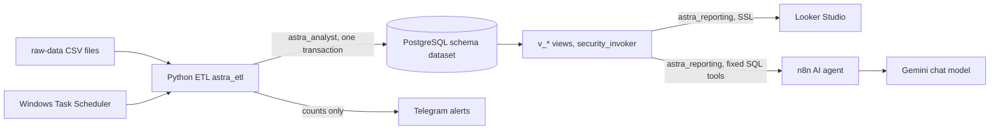

# Architecture

## Components (reference implementation)

| Component | Code / config | Notes |
|---|---|---|
| Launcher | `astra.cmd` | One command line for PowerShell and cmd. Must keep CRLF. Unknown command exits 2 |
| ETL | `src/astra_etl` (`spec.py` columns and cleaners, `clean.py`, `rules.py`, `transform.py`, `load.py`, `fix.py`, `notify.py`) | System Python 3.12, `requirements.txt` |
| Schema | `sql/migrations/*.sql` (timestamped) | Supabase Postgres 17 or local PostgreSQL |
| n8n assistant | `src/astra_n8n` → `n8n/build/*.json` (generated, not in Git) | Separate n8n instance, own data folder, loopback |
| Daily job | `scripts/daily_etl.ps1`, `scripts/register_daily_task.ps1` | Time limit, log folder, exit 124 on timeout |
| Tests | `tests/`, `pytest.ini` (`pythonpath = src`), `.venv-laya` | Offline by default |

## Database layers

- **Core tables**: one per source (customers, employees, suppliers, products, sales_transactions, service_orders,
  procurement, inventory, expenses, attendance). Typed columns, CHECK constraints, FKs, `etl_run_id`, `source_row_number`.
- **Quarantine**: `quarantine_record` (open rows only, raw record kept as JSON, rule id, failed columns, depends_on),
  `quarantine_archive` (labels only, resolution `GRADUATED` / `DUPLICATE_DROPPED` / dropped), correction log.
- **Audit**: `etl_run` (status RUNNING → SUCCEEDED/FAILED, committed first so a crash stays visible),
  `etl_run_file`, `source_file` (SHA-256 per ingested file), `dq_check_result`, rule catalog.
- **Reporting**: `v_*` views with `security_invoker = true`, KPI views (daily/monthly aggregates), quarantine monitor.

## Roles

| Role | Can | Cannot |
|---|---|---|
| writer (`astra_analyst`) | INSERT/UPDATE core and audit tables, DELETE only on `quarantine_record` | DDL, DELETE business rows |
| reporting (`astra_reporting`) | SELECT views and non-PII columns | any write, PII columns (names, emails, phones, raw quarantine record) |

Connect through the Supabase **Session pooler** (port 5432, user `<role>.<project_ref>`), `sslmode=verify-full`
with the downloaded CA. Never expose PostgreSQL publicly.
